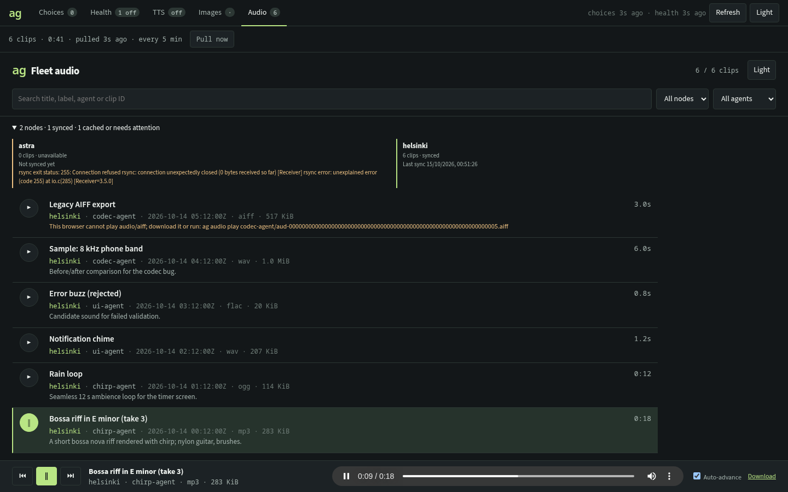

# Fleet audio and merged sync (ag 0.6)

```sh
ag audio                              # sync all enabled nodes, open the audio player
ag audio pull                         # incremental cache only; no browser
ag audio --offline                    # cached clips, no network
ag audio list -n 20 [--agent NAME]    # newest shared-clip metadata per node
ag --host ms-mac audio info 'chirp-agent/aud-<id>.mp3'
ag --host ms-mac audio get  'chirp-agent/aud-<id>.mp3' -o riff.mp3
ag audio play 'chirp-agent/aud-<id>.mp3' [--sink studio] [--server tcp:host:4713] [--volume 80] [--start 30]
ag sync                               # images + audio together, both viewers regenerated
ag sync --audio --offline             # narrow to one pathway; reindex without network
```

`ag audio` is the audio counterpart of [`ag image`](ag-gallery.md) over the [audio reel](audio-reel.md) archive: clips agents shared with `audio_share` or operators added with `/audio-add`. Speech (`/tts`, narration, read-aloud, choices) is a different feed and never appears here.

## Sync

The audio pathway reuses the image gallery machinery: incremental rsync over the configured SSH (remote nodes need rsync, not a newer `ag`), the remote login environment, strict host keys and per-node time bounds. Only registered clip/sidecar pairs whose SHA-256, size, version and `audio/*` type check out are indexed; symlinks, special files, oversized (>256 MiB) files and anything else are skipped and counted as invalid. The cache is additive and owner-private under `~/.cache/ag/audio` (`XDG_CACHE_HOME` honoured; `gallery.audio_cache_dir` or `--cache-dir` override). Failed nodes keep their cached clips with explicit `unavailable` state; `--checksum` repairs same-size/mtime corruption.

`ag sync` runs every media pathway concurrently under one `gallery.parallelism` budget. `--images` and `--audio` narrow it (no flag = all). One pathway failing — for example another pull holding its cache lock — is reported under `errors` without hiding the other. Exit 3 means a pathway or node needs attention; healthy results are still written. Image cache keys are unchanged from earlier releases, so existing image caches and last-sync stamps carry over.

## Player

The generated `index.html` is a self-contained, CSP-locked page (no network, no external assets, text-only DOM). Clips are listed newest first with title, node/agent provenance, timestamp, format, size, duration and description. Filter by node or agent, search titles/labels/IDs/descriptions, and play from the docked transport.

| Key | Action |
| --- | --- |
| `Space` | Play/pause |
| `j`/`k`, `↓`/`↑` | Select |
| `Enter` | Play selected |
| `n`/`p` | Next/previous clip |
| `←`/`→` | Seek 5 s |
| `/` | Search |

Auto-advance (on by default) continues to the next filtered clip. Formats the browser cannot play (for example AIFF or MIDI in Chromium) are marked with the exact `ag audio play <id>` fallback and a download link.

`ag audio play` prefers a verified copy in the local audio cache; otherwise it fetches the clip from one selected `--host` (checksum-verified) into a private temporary file. It decodes with `ffmpeg` and plays through the same backends as the Pi reel: Pulse by default (`PI_AUDIO_SERVER`/`PULSE_SERVER`, `PI_AUDIO_SINK`/`PULSE_SINK`), `--backend sox`, or `--backend ffplay` (CoreAudio). Ctrl-C stops and reaps both processes. Playback is CLI-only; no MCP tool plays audio.

## Dashboard

`ag dash` has an **Audio** tab next to Images. The merged sync runs every `dash.image_refresh_seconds` (default 300) for both pathways — one cadence — with separate status, counts and busy flags per pathway. **Pull now** refreshes audio alone; `POST /api/refresh {"what":["media"]}` refreshes both.

- `/audio/*` serves only the generated index and archive files inside the audio cache, behind the same token cookie and Host checks as the rest of the dashboard. Sidecars, traversal and symlink escapes return 404. Media responses stream with `Accept-Ranges: bytes`, single-range `206`/`416` (browsers need ranges to seek), `nosniff` and a sandboxing CSP. The index CSP allows only same-origin media.
- A sync that completes while a clip is playing does not reload the player underneath the listener: the tab offers **Load new clips** and applies the update once playback pauses.
- Playback happens in the browser; the dashboard server never plays audio.
- `--no-audio` / `dash.audio: false` disables audio pulls (the existing cache is still served). `--audio-cache-dir` selects the cache. Home Manager: `services.ag-dash.audio` (default `true`) and `audioCacheDirectory`.

`ag doctor` and the Health tab add an `audio` check with the last successful audio sync per node.

## Configuration

```yaml
paths:
  audio_dir: ~/.local/state/agent-utils/audio   # default PI_SHARED_AUDIO_DIR or <state>/audio on each node
gallery:
  audio_cache_dir: ~/.cache/ag/audio
dash:
  audio: true
  image_refresh_seconds: 300   # media sync cadence: images and audio
hosts:
  - name: ms-mac
    address: ms-mac
    paths:
      audio_dir: ~/different/audio
```

`--audio-dir` overrides the archive path on selected nodes (`~/` expands on each node).

## MCP

| Tool | Notes |
| --- | --- |
| `ag_audio_pull` | Incremental cache + player; `confirmed=true`; `offline` reindexes without network |
| `ag_audio_list` | Recent clip metadata per node (≤1000) |
| `ag_audio_info` | One clip's metadata from a selected node |
| `ag_sync` | All pathways (`kinds` narrows); `confirmed=true`; per-pathway errors |

None return audio bytes. Peer protocol: `ag node audio-list|audio-info|audio-read --root …`.

## Validation and visual review

Contracts: [`ag/audio-acceptance.json`](../ag/audio-acceptance.json). Rust: `ag/tests/audio.rs` (catalog validation and rejection, offline/failed retention, independent cache keys, merged sync with a held lock, CLI/MCP parity, cached playback through scripted ffmpeg/pacat, peer protocol) and `ag/tests/fleet.rs` (Audio route ranges, 416, CSP, traversal/sidecar/symlink refusal, `--no-audio`). Browser: `node scripts/ag-dash-audio-qa.mjs` (`PLAYWRIGHT_MODULE`, optional `PLAYWRIGHT_CHROMIUM`, `AG_TEST_BIN`, `AG_AUDIO_QA_OUT`) builds synthetic ffmpeg tones, starts an isolated dash, plays and seeks a clip over HTTP ranges, proves a background sync does not interrupt playback, exercises keyboard/filters/themes and checks for overflow at 390 and 320 px. Headless Chromium uses a fake audio sink; no fleet data or speakers were involved.

| State | Evidence |
| --- | --- |
| Audio tab, dark | [Screenshot](assets/ag/audio/audio-dark-1440x900.png) |
| Playing with seek | [Screenshot](assets/ag/audio/audio-playing-dark-1440x900.png) |
| Light theme | [Screenshot](assets/ag/audio/audio-light-1440x900.png) |
| Phone widths | [390 px](assets/ag/audio/audio-light-390x844.png), [320 px](assets/ag/audio/audio-light-320x600.png) |


