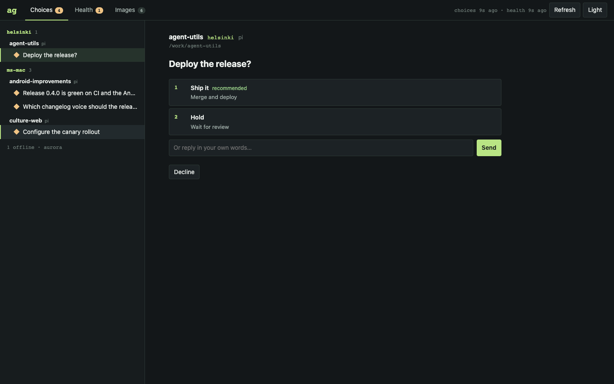
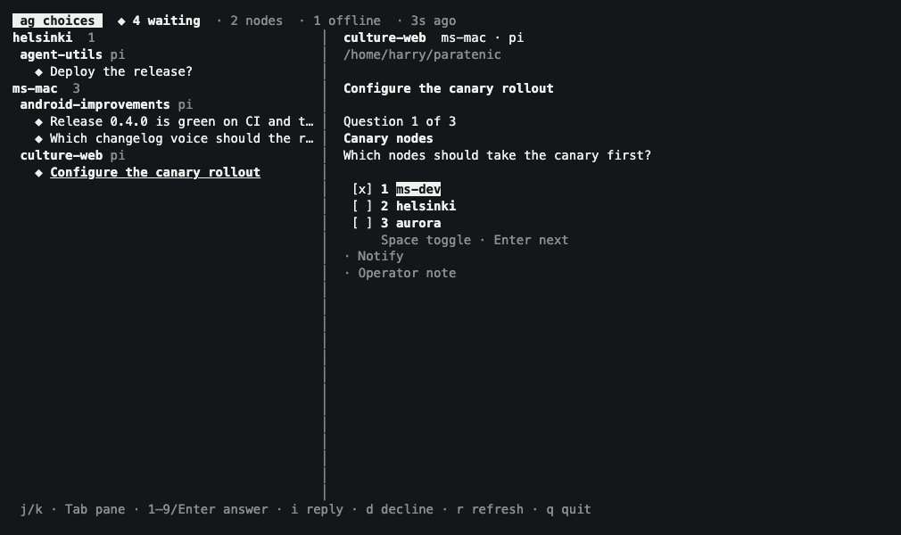
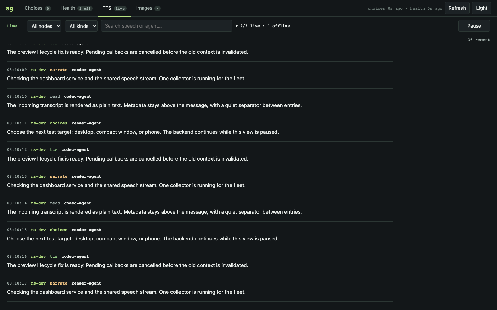

# Durable agent artifacts and the `ag` CLI

The [ag guide](../ag/README.md) documents the producer storage contract, image provenance, speech migration, SSH fleet configuration, commands, MCP schemas, failure handling, tests and Nix delivery.

Source entrypoints:

- `extensions/lib/artifact-state.js`: shared durable state paths and agent/session identity.
- `extensions/lib/tts-feed.js`: request feed appends and non-destructive legacy migration.
- `extensions/shared-images.js`: explicit Pi tool/message sharing hooks.
- `extensions/lib/shared-images.js`: private atomic image copies and provenance sidecars.
- `ag/src/`: one Rust domain core consumed by CLI, MCP and SSH peer protocol.
- `ag/flake.nix`: independently buildable CLI; root `flake.nix` exports `ag` and adds it to the binary bundle.
- `ag/acceptance.json`: contract/test inventory.
- `scripts/benchmark-ag.mjs`: isolated end-to-end startup/history/image-list latency budgets (set `AG_TEST_BIN`).

Explicit `kitty_image_preview_show` calls also preserve the shown image, including an image restored from an older session. Hide/clear/status operations and background animation/stream ticks do not generate archive copies.

## Validation (2026-09-22, macOS ARM64)

- Rust: locked build, formatting, warning-free Clippy, and 9 integration tests; CLI/MCP parity, managed config symlinks, real peer subprocess framing, quoted paths, timeout isolation, reconnect/cursors, stdin EOF and Ctrl-C cleanup.
- Extensions: 39 focused tests passed, including a real JS-writer → Nix-built Rust-reader boundary check and concurrent legacy-feed migration.
- Both root `.#ag` and standalone `./ag#ag` built with tests. Linux ARM64/x86-64 derivations evaluated; Linux execution was not tested on this host.
- Nix binary approximately 3.9 MiB. Isolated 10-sample p50/p95: startup 17/694 ms, 100 speech records from 1000 17/19 ms, 100 images from 200 32/866 ms. Budgets: p95 1s/2s/5s respectively. This measures actual process/filesystem boundaries, not network latency.
- Full JS suite: 1705 passed, 5 failed, 1 cancelled, 4 skipped. The same five failures and cancellation reproduce from the pre-change commit: missing local `pi-mcp-adapter`, devshell environment/hint assumptions, old `session_end` graphics expectations, shell-setting environment assumptions, and an opaque TTS queue test's pending promise. These unrelated failures are not masked or changed here.

## SSH transport follow-up (2026-09-23)

`ag` 0.1.1 launches peers through the remote account's noninteractive login shell, rather than assuming SSH's command PATH includes user packages. Startup chatter is routed away from protocol stdout; JSON, binary image downloads and live streams retain exact argument quoting and stdin/EOF cleanup. The 11-test Rust integration suite includes login-only PATH, noisy profiles, missing binaries, downloads, reconnects and cancellation.

A read-only probe of `ms-mac` found that its SSH/login PATH already included the Nix profile locations, but `ag` was not installed there. Login initialization cannot deploy a missing executable: each target needs the updated Collective package installed, or an explicit `hosts[].command` pointing to an installed binary. Running `cltv-run ag` on the collector alone does not install its peers. The transport now reports that distinction explicitly and never builds or switches a remote system automatically.

## Fleet choices, health and dashboard (ag 0.4)

`ag choices` answers pending agent questions from every node in one TUI, reading Paratenic's AHP `inputNeeded` state directly and answering with `chat/inputCompleted`. `ag doctor` checks SSH, Paratenic, speech and gallery freshness per node, reporting down nodes quietly as offline. `ag dash` serves them together as one live local page (choices, health, streaming TTS, embedded gallery) with periodic refresh and image pulls while it runs. See the [ag guide](../ag/README.md#fleet-choices-ag-choices) and [`fleet-acceptance.json`](../ag/fleet-acceptance.json).

### Persistent dashboard service (ag 0.4.1)

Port **7795** is the new default (7790 belongs to Petri). Both flakes export `homeManagerModules.ag-dash`, an opt-in Linux systemd user service with configurable `bindAddress`, `port`, `publicOrigin`, package/config/token/cache paths and five-minute refresh defaults. Helsinki enables it on its Tailscale IP at `http://helsinki.miku-owl.ts.net:7795`. The persistent runtime access token is stored privately outside Nix and omitted from service logs; use `?token=<token>` on the first browser visit. See [the service configuration and operator activation instructions](../ag/README.md#home-manager-service).

### Shared streaming TTS (ag 0.5)

The **TTS** tab streams the same request feed as `ag tts`: one collector inside the existing dashboard job, shared by all browsers through authenticated SSE. It continues with no viewers, reconnects with event IDs, and resets explicitly when bounded history expires. Filter by node/kind/text; scroll up to pause, then jump back to live. No browser audio or provider changes.

Default startup history is 20 lines per host; `dash.tts`, `dash.tts_lines`, `--no-tts`, `--tts-lines` and Home Manager `tts`/`ttsLines` are configurable. The buffer is bounded to 500 events / 2 MiB, with 16 KiB visible text per entry and no persisted duplicate transcript. See [streaming operation and diagnostics](../ag/README.md#streaming-speech-ag-05), [acceptance inventory](../ag/tts-dash-acceptance.json) and [visual review](assets/ag/tts/review.md).

## Fleet image viewer (ag 0.3)

`ag image` now bulk-syncs selected/all enabled nodes and opens a local browser gallery. `ag image pull` fills the same incremental rsync cache without opening a browser, and `ag image --offline` reads cached images without network. The gallery indexes all validated registrations rather than the recent-list cap, with node/agent filtering, search and full-size previews. Failed nodes retain visibly cached data. See [the gallery guide and validation](ag-gallery.md).

## Runtime speech control (ag 0.2)

`ag tts mute`, `unmute`, and `status` now share a private atomic per-node policy with Agent Utils. All enabled nodes/all four speech types are the default; host/local and type flags narrow the operation. See [the control contract](speech-runtime-control.md) for names, epoch fencing, path overrides, partial-failure receipts and enforcement semantics.

Validation: 16 Rust integration tests, 133 focused JS tests, both Nix package entrypoints, and the Nix-built CLI → JS controller boundary passed. Twenty consecutive control/playback runs cover live mute, symlink updates, queue recovery and observer cleanup. Stress testing exposed dropped macOS filesystem events, so event watchers have an active-only 200 ms metadata reconciliation fallback; there is no idle polling or periodic state/lock writer. No production audio or node mute policy was changed during validation.

The archives are intentionally **not caches**. Session shutdown, preview cleanup and PCM queue maintenance never delete them. Archive retention/backups are operator-owned. No daemon or automatic remote upload is introduced; the explicit `ag` invocation reads selected configured nodes using existing SSH authentication.
