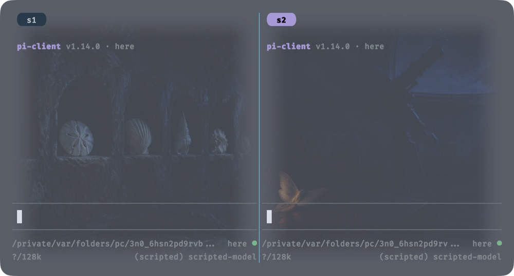
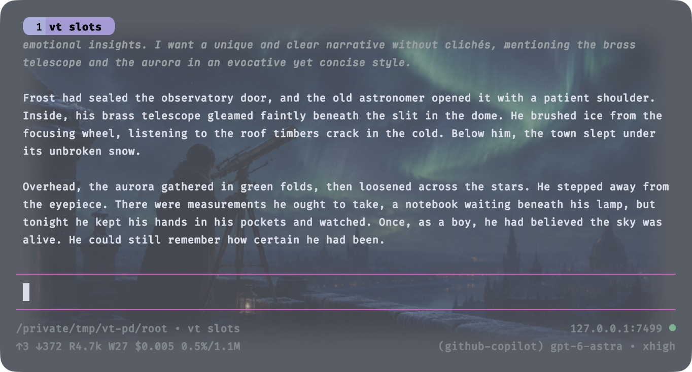
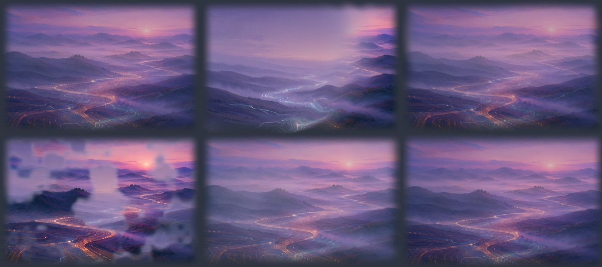
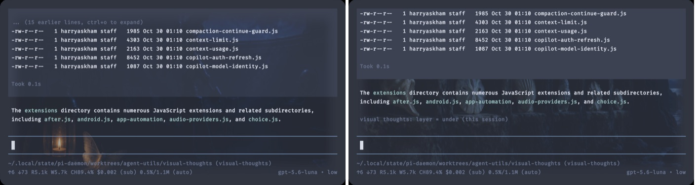
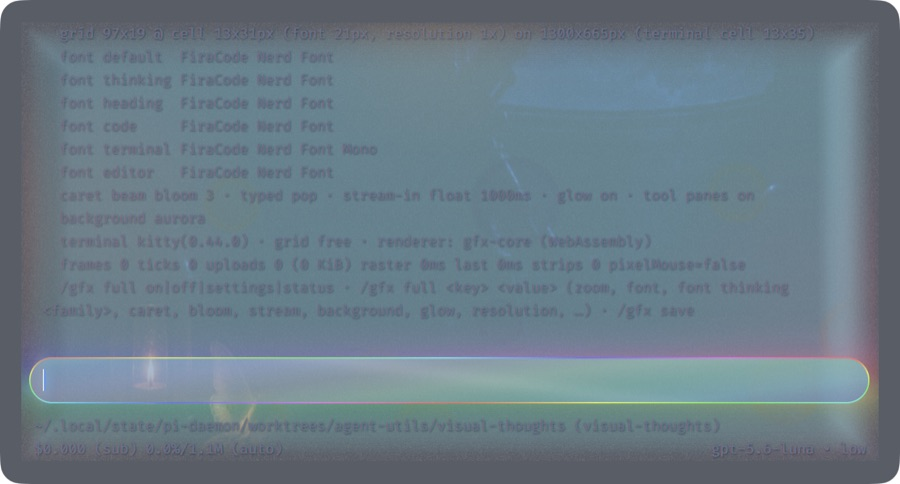

# Visual thoughts

`extensions/visual-thoughts.js` paints the agent's work. While the agent thinks, replies and calls tools, a fast model turns its latest output into an image prompt, an image model paints it, and the images crossfade as a soft backdrop behind Pi's screen. Text stays on top; the backdrop never blocks the agent.

```text
/thoughts                 status: on/off, what it is doing, images, last prompt and error
/thoughts on|off|toggle   for this session
/thoughts now             paint from the current output now
/thoughts next            crossfade to the next image
/thoughts clear           drop the images (the files stay)
/thoughts opacity 0.4     change a setting for this session (see below; effect ripple, fps 30, …)
```

It is off by default. Enable it at startup with `agentUtils.visualThoughts.enabled` or `PI_VISUAL_THOUGHTS=1`. Incognito sessions (`PI_INCOGNITO=1`) never paint.



## How it paints

- **What feeds it.** The run's prompt, streamed reasoning and reply text, and tool calls (names and redacted arguments) go into a bounded digest. Secrets are redacted as for `/narrate`.
- **When it paints.** The first image of a run needs `firstChars` of new output, later ones `minChars`, at least `minIntervalMs` apart, at most `maxPerRun` per run, one at a time. When the run ends, what is left paints once more. Rate limits wait for the provider's reset; other failures back off (15 s doubling to 5 min) and warn once.
- **The prompt.** `promptModel` (default `github-copilot/gpt-6-luna`, through Pi's model registry) writes one 20–45 word visual metaphor for the work: no text, code, screens or literal values; soft, low-contrast and mostly dark so text stays readable; varied from the last few prompts. `style` is appended as a house style.
- **The image.** `provider: "litellm"` posts to an OpenAI-compatible `/v1/images/generations` (`LITELLM_BASE_URL`, key from `LITELLM_MASTER_KEY`); `provider: "mai"` posts to `<maiEndpoint>/mai/images/generations` with an Entra token from `az` (or `maiAuth: "key"`).
- **The rotation.** Each run's images form a batch. The backdrop cycles the newest batch (each held `holdMs`, crossfaded over `fadeMs`); while it has fewer than `minSet` images the latest earlier ones join, so there is always recent imagery and a new run's images take over one by one. A new image is shown once the current one has had `minShowMs`.
- **Where images go.** `~/.local/state/agent-utils/visual-thoughts/<session>/` keeps each PNG and an `index.jsonl` of prompts (the newest `keep`). A reloaded or resumed session starts from its recent images. Sessions untouched for 14 days go, and the oldest go while the store is over 1.5 GB.

Measured on 2026-10-30 (sandbox deployments, ~30-word prompts): `gpt-image-2.5-flare` at 1536×1024 `quality=low` ~14 s through LiteLLM; `MAI-Image-2.5-Flash` / `2.6-Flash` ~10 s at 768×768 and ~13 s at 1344×768 (768 px minimum per side), limited to 2 requests a minute per deployment; `gpt-image-2` / `2.5-sunburst` ~22 s; `gpt-image-1.5` ~28 s. The prompt model adds 2–5 s.

## pi-daemon sessions: painted once, for every client

List `extensions/durable/visual-thoughts.mjs` (the package's `visual-thoughts.mjs`) in a pi-daemon profile's `extensions`. With pi-daemon 1.15+ (session UI slots), the session's worker paints, once per session, and every client shows the same images: each pi-client pane on the session, on any machine, `/web` and Culture (AHP `_meta["pi-daemon/ui"]`).

- **The slot.** The module owns the session's `backdrop` slot: `{ kind: "image-set", images, current, hints }`. `images` are the newest `slotImages` paintings, stored as the session's media (PNG; a painting over the 2 MiB limit is scaled down on a worker thread first); `current` is the one to show now; `hints` say how (`placement`, `opacity`, `fit`, `feather`, `cycleMs` from `holdMs`, `transition`). The module claims the slot, empty, as soon as it meets a session, so clients never paint it themselves as well.
- **Clients show it.** pi-client sees the module among the session's commands and follows the slot (`session.watchDocument`): images are fetched once by URI, the hints set the look and the cycle, a new `current` is shown once the shown image has had `minShowMs`, and the transitions (effect, fps, layer) stay the client's own. A session without the module, an older pi-daemon (no slots: the module stays quiet) and TUI Pi paint locally as before.
- **`/thoughts` in pi-client goes to the session.** `on`, `off`, `now`, `next`, `clear`, `status` and the painting settings run as the module's command, for every client: `off` empties the slot; `next` moves everyone on. The display settings (`effect`, `fps`, `layer`, `pixels`, `fade`, `min-show`, `canvas-opacity`, `transport`) stay with the pane. A session's on/off and settings persist in the module's session state.
- **Prompts** use the session's model registry (`promptModel`), so `github-copilot/…` models work there too; `LITELLM_BASE_URL` and `LITELLM_MASTER_KEY` come from the worker's environment (the profile's `envFiles`).



## Display

TUI Pi in fullscreen mode (`tuiMode: fullscreen`) on a Kitty-graphics terminal (Kitty, Ghostty, WezTerm), and pi-client.

- **pi-client: each pane paints its own session.** Add `extensions/visual-thoughts.js` to `client.extensions`. pi-client gives each pane a backdrop (`ctx.ui.backdrop()`, pi-daemon 1.15+): the images sit inside the pane, never over its neighbours, the dividers or the sidebar, and follow splits, zoom and tabs. The focused pane paints and cycles; the others hold their current image still, made again at their new size when the layout changes. A pane switched to another session starts from that session's images. pi-client runs extensions without the agent's process, so the prompt model there is `clientPromptModel` (default `deepseek-v4-flash`) on the OpenAI-compatible endpoint (`LITELLM_BASE_URL`); `promptModel: "litellm/<model>"` does the same in TUI Pi.



- **Holds are sharp and free.** Each image is fitted and uploaded once, at the screen's real resolution (Pi's cell size in device pixels, so HiDPI is right) or the source's, whichever is smaller, then placed over the whole screen under the text. Holding an image costs nothing.
- **Transitions run on a worker thread.** A transition is one of `ripple` (a ring spreads from a point, the water rippling at its edge), `wave` (heat haze: rows sway while the new image rises through), `dissolve` (soft noise with a faint glow along its edge), `bloom` (both images drift outwards and glow midway) or `drift` (the old image recedes as the new one settles in), or a plain `fade`; `random` (the default) picks one of the first five each time. Frames render at up to `transitionPixels` (400k by default) on a worker and play at `fps` (60 by default; frames the renderer cannot deliver in time are skipped, never queued). A frame costs the renderer 2–10 ms at 690×580 and Pi's own thread a few hundred bytes of output.
- **Frames travel as files.** When the terminal runs on this machine, a frame is raw RGBA in a temporary file the terminal reads and deletes (`t=t`): no PNG encoding, no base64. Over SSH or inside tmux, frames go inline, zlib-compressed.
- **With `/gfx full` (pi-graphics' canvas, either renderer), the thoughts blend into its background.** The backdrop sits just above the canvas's background (aurora, nebula, waves, …) and its tint, under its glow, cards and text, at `canvasOpacity` (0.45 by default): the animated background glows through the image's soft edges and shadows, and both keep moving. The canvas tells the backdrop when it starts, stops or clears the screen, and the backdrop comes back at once.




- **Pi's redraws are handled.** Pi deletes every placement when its own images change and frees images on full redraws; the extension watches Pi's output and puts the backdrop back inside the same frame, uploading again what was freed.

tmux is not supported yet (`PI_VISUAL_THOUGHTS_TMUX=1` to try). `PI_VISUAL_THOUGHTS_TRACE=<file>` logs transitions, frames and main-thread stalls.

## Settings

`agentUtils.visualThoughts` in `settings.json` (startup policy; `/thoughts <key> <value>` changes the running session only; `hold`, `fade`, `interval` and `min-show` take seconds).

| Key | Default | |
|---|---|---|
| `enabled` | `false` | paint from startup |
| `promptModel` | `github-copilot/gpt-6-luna` | `provider/id` from Pi's registry, or `litellm/<model>` |
| `clientPromptModel` | `deepseek-v4-flash` | the chat model where there is no registry (pi-client) |
| `provider` | `litellm` | `litellm` or `mai` |
| `imageModel` | `gpt-image-2.5-flare` | MAI: `MAI-Image-2.5-Flash` |
| `size`, `quality` | `1536x1024`, `low` | MAI: `1344x768` |
| `style` | | appended to every prompt |
| `opacity` | `0.3` | backdrop alpha |
| `canvasOpacity` | `0.45` | backdrop alpha blended into `/gfx full`'s background (`canvas-opacity` at runtime) |
| `fit` | `cover` | `cover`, `contain`, `stretch` |
| `feather` | `0.12` | edge fade, fraction of the shorter side |
| `layer` | `auto` | `under` cell backgrounds (panels, tool boxes and dialogs stay solid; the image shows around the text) or `over` them (tints everything); `auto`: `under`, but `over` inside herdr |
| `holdMs`, `fadeMs` | `18000`, `2800` | |
| `effect` | `random` | `ripple`, `wave`, `dissolve`, `bloom`, `drift`, `fade` |
| `fps` | `60` | transition frame rate |
| `transitionPixels` | `400000` | transition frame size (`pixels` at runtime) |
| `minIntervalMs` | `12000` | between paintings |
| `firstChars`, `minChars` | `160`, `600` | new output needed |
| `maxPerRun`, `maxImages`, `minSet` | `10`, `8`, `3` | |
| `slotImages` | `8` | paintings a pi-daemon session's backdrop slot keeps (`images` at runtime) |
| `keep` | `24` | stored images per session |
| `transport` | `auto` | `file` (`t=t`) or `stream` (inline) |

Environment: `PI_VISUAL_THOUGHTS`, `PI_VISUAL_THOUGHTS_PROMPT_MODEL`, `PI_VISUAL_THOUGHTS_IMAGE_MODEL`, `PI_VISUAL_THOUGHTS_PROVIDER`, `PI_VISUAL_THOUGHTS_OPACITY`, `PI_VISUAL_THOUGHTS_DIR`, `PI_VISUAL_THOUGHTS_SESSION` (use another session's stored images), `PI_VISUAL_THOUGHTS_TRACE`.
